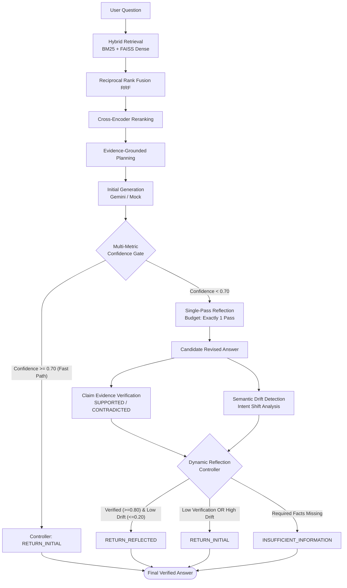

# 🛡️ RAGVerify

> **Confidence-Gated Ultra-Lightweight Reflection RAG Framework & Evaluator Dashboard**

[](https://www.python.org/)
[](https://fastapi.tiangolo.com)
[](https://react.dev/)
[](https://www.typescriptlang.org/)
[](https://opensource.org/licenses/MIT)

---

## 📌 Overview

**RAGVerify** bridges the gap between fast, unverified retrieval pipelines and slow, token-heavy self-reflective systems.

* **Traditional RAG** suffers from unchecked hallucinations on low-evidence queries.
* **Multi-Turn Reflective RAG** introduces high latency, unpredictable token loops, and semantic drift.
* **RAGVerify** uses a **multi-metric confidence gate** to fast-track confident queries, triggering a **single-pass ultra-lightweight reflection** only when needed, backed by strict **claim-level evidence verification** and **semantic drift detection**.

---

## 🔄 Pipeline Architecture



---

## ⚖️ Architecture Comparison

| Feature / Capability | Traditional RAG | Always-Reflective RAG | 🛡️ RAGVerify (Proposed) |
| :--- | :---: | :---: | :---: |
| **Retrieval Strategy** | Dense-only | Dense-only | **Hybrid (BM25 + FAISS Dense + RRF)** |
| **Re-ranking** | ❌ None | ❌ None | **Cross-Encoder (`ms-marco-MiniLM`)** |
| **Fact Planning** | ❌ None | ❌ None | **Required vs. Missing Fact Extraction** |
| **Confidence Gating** | ❌ None | ❌ None | **5-Metric Non-LLM Gate** |
| **Reflection Overhead** | 0 extra calls *(Hallucination prone)* | Unbounded iterations *(High latency & cost)* | **Single-Pass Reflection (Budget = 1)** |
| **Claim Verification** | ❌ None | ❌ None | **Fine-grained evidence claim check** |
| **Semantic Drift Check** | ❌ None | ❌ None | **Cosine semantic & requirement drift** |
| **Decision Arbiter** | ❌ None | ❌ None | **Dynamic Reflection Controller** |

---

## 🚦 Decision Matrix

The **Dynamic Reflection Controller** acts as the final arbiter to guarantee accuracy and prevent degradation:

| Rule | Condition | Decision | Selected Answer | Rationale |
| :---: | :--- | :---: | :---: | :--- |
| **1** | High Confidence Gate (`confidence >= 0.70`) | `RETURN_INITIAL` | Initial Answer | Skips reflection entirely (Fast path) |
| **2** | `v_score >= 0.80` **AND** `d_score <= 0.20` | `RETURN_REFLECTED` | Reflected Answer | Reflection verified and aligned with original query intent |
| **3** | `v_score < 0.80` **OR** `d_score > 0.20` | `RETURN_INITIAL` | Initial Answer | Rejects ungrounded or drifted revisions |
| **4** | Missing facts $\ge$ Required facts | `INSUFFICIENT_INFORMATION` | Fallback Guardrail | Prevents hallucinations when evidence is absent from corpus |
| **5** | Exception in any pipeline stage | `SAFE_FALLBACK` | Initial Answer | Graceful fallback without crashing the API |

---

## 📂 Repository Structure

```text
RAGVerify/
├── backend/                       # High-performance FastAPI core
│   ├── confidence/                # Multi-metric confidence estimator & gate
│   ├── controller/                # Dynamic reflection decision controller
│   ├── drift/                     # Semantic drift & intent shift detector
│   ├── generation/                # LLM client (Google Gemini & Mock provider)
│   ├── ingestion/                 # Document parsing, chunking & FAISS indexer
│   ├── planning/                  # Evidence-grounded fact planning module
│   ├── reflection/                # Single-pass ultra-lightweight reflection
│   ├── retrieval/                 # BM25 + FAISS Dense + RRF + Cross-Encoder
│   ├── services/                  # Pipeline orchestration & trace storage
│   └── main.py                    # REST API endpoints & CORS setup
├── frontend/                      # React 19 + TypeScript + MUI dashboard
│   ├── src/components/            # Visualizer, confidence gate, drift & trace panels
│   └── src/App.tsx                # Interactive evaluation & inspection interface
├── data/                          # Sample documents & evaluation benchmarks
│   ├── evaluation/                # Test questions & ground truth datasets
│   └── sample_documents/          # Document corpus for vector indexing
├── evaluation_runner.py           # CLI benchmark runner across all 3 baseline systems
└── requirements.txt               # Backend Python dependencies
```

---

## 🚀 Quickstart

### 1. Backend Setup

```powershell
# Create and activate virtual environment
python -m venv .venv
.\.venv\Scripts\Activate.ps1

# Install dependencies
pip install -r requirements.txt

# Start FastAPI server
uvicorn backend.main:app --reload --port 8000
```
> API will run at `http://127.0.0.1:8000` (Interactive Swagger Docs: `http://127.0.0.1:8000/docs`).

### 2. Frontend Dashboard

```powershell
cd frontend
npm install
npm run dev
```
> Evaluator Dashboard runs at `http://localhost:5173`.

### 3. Run Benchmark Suite

Compare all three architectures against the benchmark dataset:

```powershell
# Run evaluation across Traditional, Always-Reflection, and RAGVerify
python evaluation_runner.py --system all
```

---

## 🔌 API Endpoints

| Method | Endpoint | Description |
| :--- | :--- | :--- |
| `POST` | `/ingest` | Parse, chunk, and index documents in `data/sample_documents/` |
| `POST` | `/query/phase2` | Run query through RAGVerify with full trace generation |
| `GET` | `/traces` | List recent query trace summaries |
| `GET` | `/trace/{request_id}` | Retrieve complete stage-by-stage pipeline execution trace |
| `GET` | `/system/config` | View active thresholds, models, and retrieval configurations |
| `GET` | `/health` | Health check endpoint |

---

## ⚙️ Configuration (`.env`)

Configure thresholds and providers directly in your `.env` file:

```env
# LLM Provider: "mock" (offline test mode) or "gemini"
LLM_PROVIDER=gemini
LLM_MODEL=gemini-2.5-flash
LLM_API_KEY=your_gemini_api_key_here

# Pipeline Thresholds
CONFIDENCE_THRESHOLD=0.70
VERIFICATION_THRESHOLD=0.80
DRIFT_THRESHOLD=0.20
MAX_REFLECTION_ATTEMPTS=1

# Retrieval & Re-ranking
BM25_TOP_K=10
DENSE_TOP_K=10
RRF_K=60
RERANK_TOP_K=5
```

---

## 🧪 Testing

Run test suite covering all phases and decision branches:

```powershell
python -m pytest tests -q
```

---

## 📄 License

This project is licensed under the [MIT License](LICENSE).
